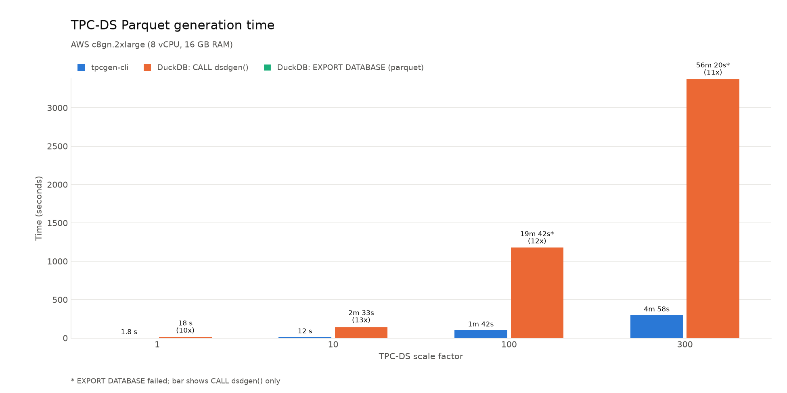
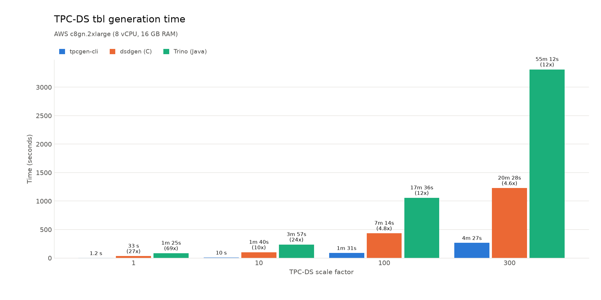

# TPC-DS Generator Benchmarks

## Default (8 cores)





## Experimental Setup

All measurements were gathered on a [`c8gn.2xlarge`] instance (8 vCPU, 16 GB
RAM, aarch64 / Graviton) from AWS. For storage, we used two 1100 GB [gp3] EBS
volumes configured as RAID 0, each with 2000 MiB/s of provisioned throughput
and 4000 IOPS.

Note that the storage configuration is critical. `tpcgen-cli` generates data at
around 1.2 GB/s on a `c8gn.2xlarge`, well above the gp3 baseline of 125 MiB/s.
Even with gp3 provisioned at 2000 MiB/s per volume (the max), a single volume
still left the CPUs stalled on I/O, so we used two volumes.

The volumes were attached as `/dev/sdb` and `/dev/sdc`, combined into a RAID 0
array with `mdadm`, and formatted with ext4:

```shell
sudo mdadm --create --verbose /dev/md0 --level=0 --raid-devices=2 /dev/sdb /dev/sdc
sudo mkfs -t ext4 /dev/md0
sudo mkdir -p /data
sudo mount /dev/md0 /data
```

We ran the benchmark script with the following command:
```shell
DSDGEN_DIR=/home/ec2-user/DSGen-software-code-4.0.0/tools/ ./tpcds_benchmark.sh --output-dir /data/bench-data
```

We compared four generators:
* `tpcgen-cli` (Rust) -- this repo
* [`dsdgen`] (C) -- the official TPC-DS generator (version 4.0.0)
* [`trino`] (Java) -- the Trino port of the TPC-DS generator (version 1.5-SNAPSHOT)
* [`duckdb`] (C++) -- the DuckDB TPC-DS extension (DuckDB version 1.5.6)

Here are the commands used to run each generator:

| Format  | Tool         | Command                                                      |
|---------|--------------|--------------------------------------------------------------|
| tbl     | `tpcgen-cli` | `tpcgen-cli tpcds dat --num-threads N`                       |
| tbl     | `dsdgen`     | N processes: `dsdgen -PARALLEL N -CHILD i`                   |
| tbl     | `trino`      | `java -jar tpcds.jar --parallelism N`                        |
| parquet | `tpcgen-cli` | `tpcgen-cli tpcds parquet --num-threads N`                   |
| parquet | `duckdb`     | `CALL dsdgen(sf)` into a `.duckdb` file, then `EXPORT DATABASE (FORMAT parquet)` |

Generate the plots with:
```shell
uv run plot_tpcds_benchmark.py tpcds_benchmark.csv --subtitle "AWS c8gn.2xlarge (8 vCPU, 16 GB RAM)"
```

[`c8gn.2xlarge`]: https://aws.amazon.com/ec2/instance-types/c8g/
[gp3]: https://docs.aws.amazon.com/ebs/latest/userguide/general-purpose.html
[`dsdgen`]: https://www.tpc.org/tpcds/
[`trino`]: https://github.com/trinodb/tpcds
[`duckdb`]: https://duckdb.org/docs/stable/core_extensions/tpcds
